<p align="center">
  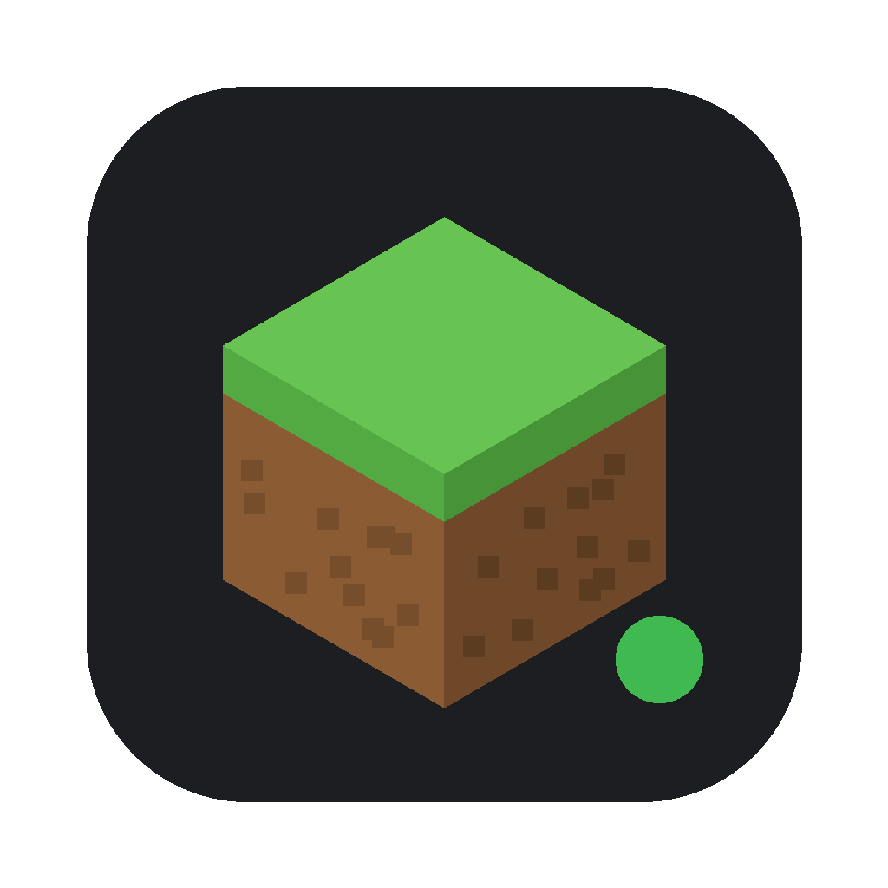
</p>

<h1 align="center">Blockyard</h1>

<p align="center">
  <b>Host a Minecraft server on your Mac or PC, without the terminal.</b><br>
  Paper, Purpur, Fabric, Forge, NeoForge, Vanilla and modpacks, with a console, players, plugins, stats, crossplay and safe public access in one small app.
</p>

<p align="center">
  <a href="https://github.com/Ek2100/blockyard/releases/latest"></a>
  
  <a href="LICENSE"></a>
  <a href="https://github.com/Ek2100/blockyard/actions/workflows/ci.yml"></a>
</p>

<p align="center">
  <a href="https://github.com/Ek2100/blockyard/releases/latest"><b>⬇︎ Download for Mac, Windows or Linux</b></a>
</p>

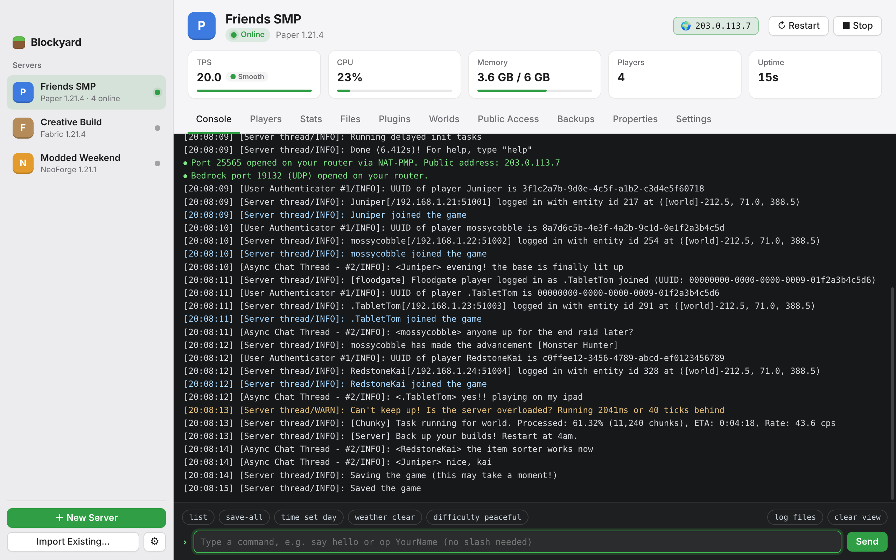

Blockyard is a free, lightweight app (written in Rust) that runs the normal Minecraft server for you. It downloads the server and the right Java, starts it, and gives you buttons for everything you'd otherwise type. Your server stays a plain, standard Minecraft folder, so you can open it in any other tool or move it to a host later.

## Features

**Make a server in a minute.** Choose a fresh world, one of your singleplayer worlds, or a server folder you already have. Pick the software and version, say who's playing, and Blockyard sets up the rest, including Java.

**Turn a singleplayer world into a server.** Blockyard copies the world (your original is never touched), keeps its game mode and difficulty, and moves your inventory and position to your account so you spawn where you left off.

**Let friends join from anywhere, safely.** Choose *Friends anywhere* and Blockyard opens the port on your router (UPnP / NAT-PMP), then checks from the internet that it worked. If your provider blocks incoming connections (Starlink, 4G/5G home internet), it sets up a free [playit.gg](https://playit.gg) tunnel instead, or friends can connect straight to your IPv6 address when your connection has one. It also turns the whitelist on, keeps you and anyone already playing on it, and explains the risks in plain words.

**Invite friends.** Type a friend's username: Blockyard looks up their account, adds them to the whitelist and writes the message to send them, address included.

**Sleep mode.** When nobody has been online for a while, the server stops to free memory and power. It stays visible as "asleep" in your friends' server lists and starts again as soon as a whitelisted player tries to join. Strangers can't wake it.

**Modpacks.** Install any Modrinth modpack (search, or open a `.mrpack` file). Blockyard sets up the exact Fabric, Forge or NeoForge version, downloads every mod with its checksum checked, copies the pack's settings and skips client-only mods.

**Bedrock crossplay.** One click installs Geyser and Floodgate, so friends on phones, tablets, Windows and consoles can join your Java server.

**Real performance numbers.** TPS and tick time are measured quietly in the background, using Paper's `tps`/`mspt` or vanilla's `tick query`. Charts show TPS, tick time, CPU, memory and players over the last 15 minutes, hour or 6 hours, and each player's playtime is tracked.

**Plugins and mods from Modrinth.** Search for your exact software and version, install with one click (required dependencies included, checksums verified), and update everything at once.

**Everything else you'd want:**
- Console with colour-coded warnings and errors, command history and quick commands
- Players: kick, ban, op, gamemode; whitelist, ops and ban lists
- File browser and editor, with drag-and-drop from Finder or File Explorer
- A form for `server.properties`
- World switching, resets with a new seed, and copying server worlds back to singleplayer
- Changing the Minecraft version safely, with a backup first and downgrades blocked
- Backups on demand or on a schedule, with one-click restore
- Auto-restart after a crash, daily restarts with warnings, scheduled commands
- Discord notifications, a log and crash-report viewer, a menu bar / system tray icon, and alerts when players join
- Opens at login and starts your servers by itself, if you want
- Keeps your computer awake while a server runs, and stops servers cleanly when you quit

## Screenshots

| | |
|---|---|
| 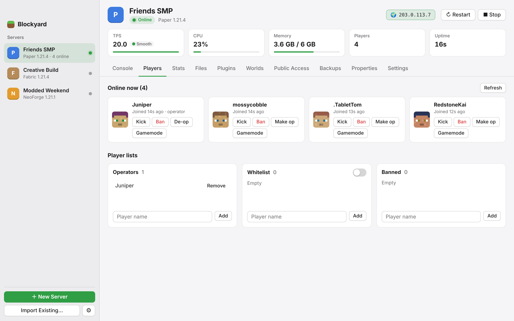 | 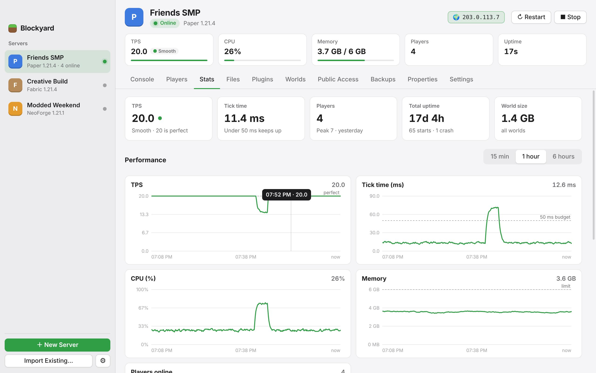 |
| **Players**: kick, ban, op and manage lists | **Stats**: real TPS and tick time over time |
| 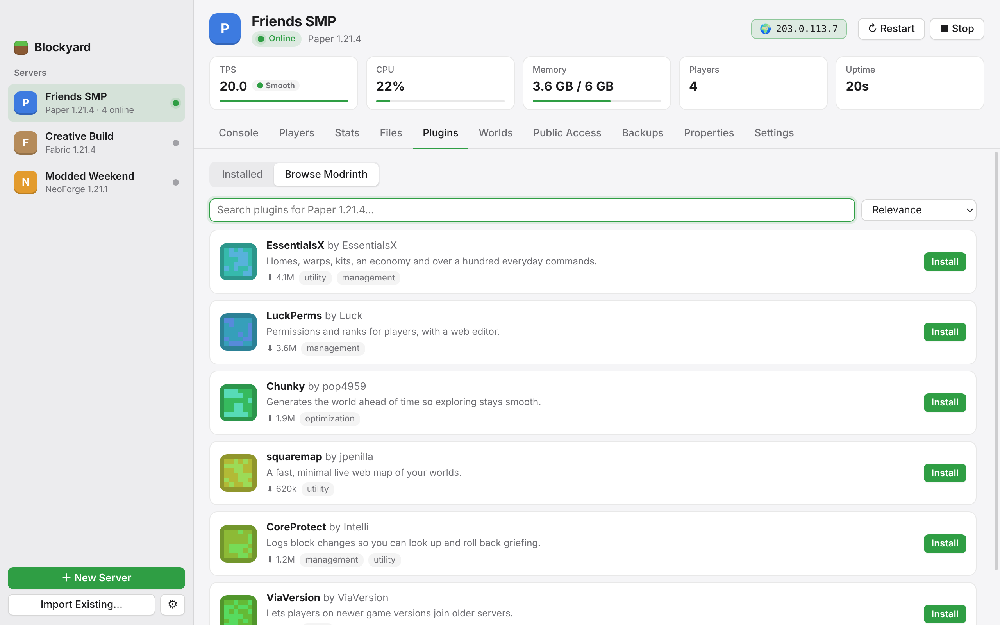 | 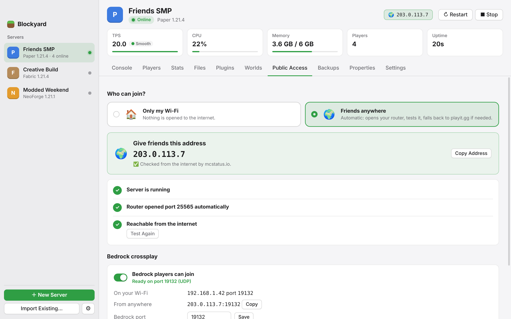 |
| **Plugins & mods** straight from Modrinth | **Public Access** that tests itself |
| 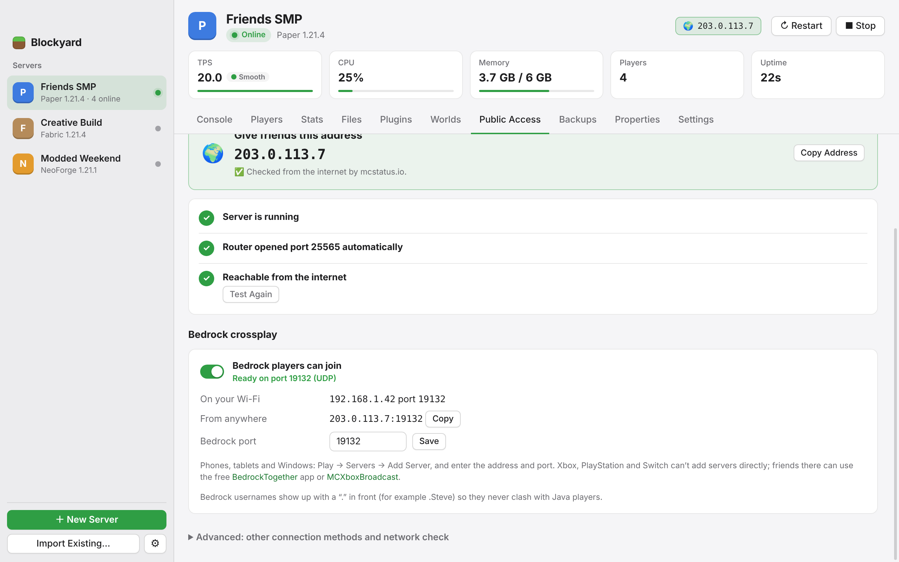 | 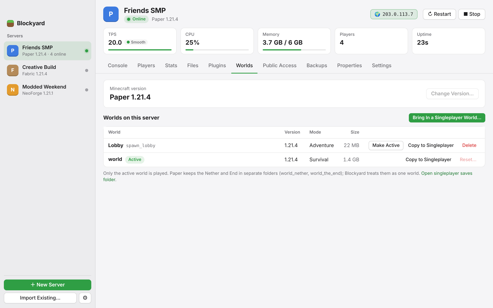 |
| **Bedrock crossplay** with Geyser + Floodgate | **Worlds**: switch, reset, copy |
| 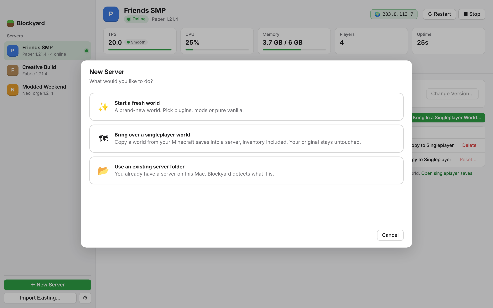 | 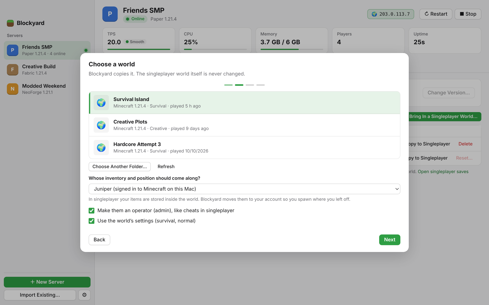 |
| **New Server** wizard | **Bring in a singleplayer world** |

It follows your system's light or dark appearance:

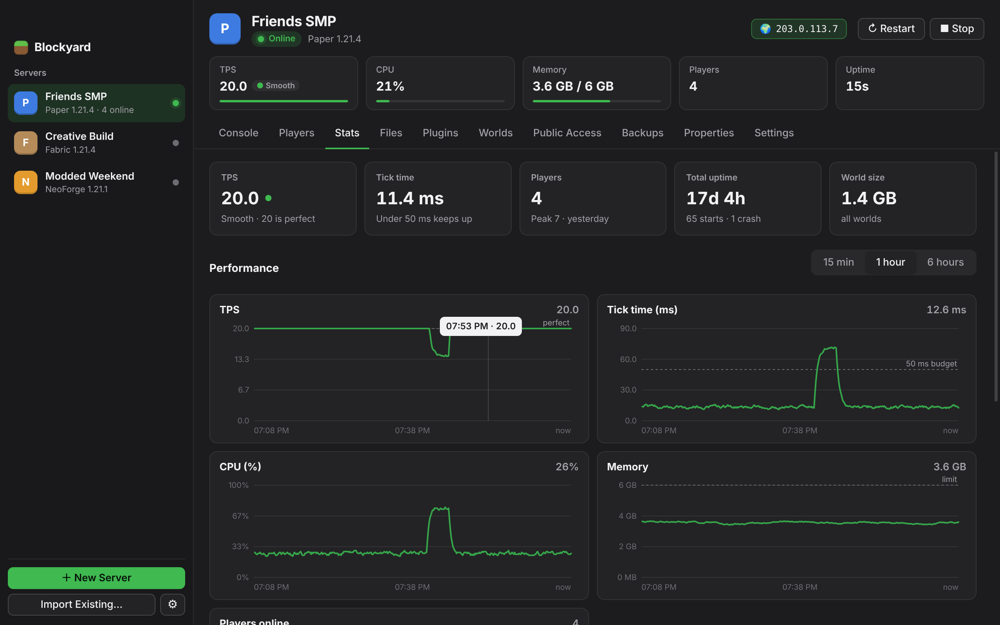

## Install

Download from the [latest release](https://github.com/Ek2100/blockyard/releases/latest):

| | |
|---|---|
| **Mac** (Apple Silicon and Intel, macOS 11+) | `Blockyard_x.y.z_universal.dmg`: open it and drag Blockyard into Applications. |
| **Windows 10/11** | `Blockyard_x.y.z_x64-setup.exe` installs it. `Blockyard_x.y.z_x64-portable.exe` is a single file that runs without installing. On ARM PCs (Snapdragon, Surface Pro X), use the `arm64` files. |
| **Linux** | `Blockyard_x.y.z_amd64.AppImage` (make it executable and run it) or `Blockyard_x.y.z_amd64.deb` for Ubuntu/Debian. On ARM (Raspberry Pi 5, ARM servers), use the `aarch64` files. |

You don't need to install Java first: Blockyard downloads the right version when a server needs it.

**First launch on Mac:** macOS says it can't check the app for malware, because Blockyard isn't notarized by Apple (that needs a paid developer account). Click **Done**, then open **System Settings → Privacy & Security**, scroll down and click **Open Anyway** next to Blockyard. You only do this once. If macOS says the app is "damaged", run this once in Terminal and open it again:

```sh
xattr -dr com.apple.quarantine /Applications/Blockyard.app
```

**First launch on Windows:** if SmartScreen says "Windows protected your PC", click **More info → Run anyway** (Blockyard isn't code-signed yet). The first time a server starts, Windows asks whether Java may use the network: click **Allow**, or friends outside your home can't connect. Public Access has a button to fix it if you missed the prompt.

**Updating:** Blockyard tells you when a new version is out (you can turn this off in ⚙︎ Settings). Download it and install it over the old one. Your servers and settings aren't touched.

## FAQ

**Is it really free?** Yes. It's open source under the MIT licence. There are no accounts, ads or paid features.

**Can my computer run a Minecraft server well?** Most can. A few friends on Paper is comfortable on any Apple Silicon Mac or recent PC with 8 GB of memory; give the server more memory for big modpacks.

**Does my computer need to stay on?** Yes. The server runs on your computer, so friends can only join while it's awake and Blockyard is running. Blockyard stops idle sleep while a server runs, but closing a laptop's lid usually still sleeps it.

**Is opening my server to the internet safe?** Mostly, if you keep two things on: the **whitelist** (Blockyard turns it on for you) and **online-mode** (the default). The risks, in short:
- Bots scan the internet for Minecraft servers all the time, so strangers find public servers within hours. The whitelist keeps them out.
- The server runs as you. A security hole in the server software or a malicious plugin could reach your files, so keep the server and plugins up to date and install them only from places you trust. Blockyard checks Modrinth downloads.
- Router port forwarding shares your home internet address with the people you give it to; playit.gg hides it.

The router only opens the Minecraft port, and only while the server is running or sleeping.

**Can I use it with a server I already have?** Yes. Use **Import Existing…** and pick the folder. Blockyard detects the software, version, jar and port.

**Which systems?** macOS 11+ (Apple Silicon and Intel), Windows 10 and 11 (Intel/AMD and ARM), and Linux (Intel/AMD and ARM, as AppImage or .deb). playit.gg tunnels are available on Mac and Windows.

## Privacy

Blockyard has no analytics and no account. It only contacts outside services to do what you ask:

| Service | When |
|---|---|
| Mojang, PaperMC, Purpur, Fabric, Forge, NeoForge | Downloading server software and version lists |
| Adoptium | Downloading Java, if your Mac needs it |
| Modrinth, GeyserMC | Searching for and downloading plugins and mods, and crossplay |
| ipify / icanhazip | Finding your public IP for Public Access |
| mcstatus.io / mcsrvstat.us | **Test from Internet**: these services try to connect to your server's address |
| playit.gg | Only if you choose the playit.gg tunnel |
| mc-heads.net | Player head pictures in the Players and Stats tabs |
| Modrinth | Modpacks you choose to install |
| Mojang API | Looking up a player's account when you invite them or import a world |
| Discord | Only if you add a webhook |
| GitHub | Checking for new Blockyard versions (can be turned off) |

## Where things live

- **Servers:** wherever you choose. The default is `~/Minecraft Servers/<name>` (Windows: `Documents\Minecraft Servers\<name>`).
- **App data** (server list, stats, downloaded Java, playit agent, logs):
  - Mac: `~/Library/Application Support/app.blockyard.desktop/`
  - Windows: `%APPDATA%\app.blockyard.desktop\`
  - Linux: `~/.local/share/app.blockyard.desktop/`
- **Logs:** Help → Show Blockyard Logs

## Building from source

You need [Rust](https://rustup.rs) and Node.js 20+. Tests also need Java 17+. On Linux, install the WebKit libraries first (`libwebkit2gtk-4.1-dev libgtk-3-dev libayatana-appindicator3-dev librsvg2-dev`).

```sh
git clone https://github.com/Ek2100/blockyard.git
cd blockyard
npm install
npm run dev          # run the app in development
npm test             # engine tests: a fake Minecraft server, fake router, fake playit and mocked web services
npm run test:ui      # the real UI in a headless browser, against the real engine
npm run build        # the app and installer for this system, in target/release/bundle
```

### Project layout

```
core/        The engine (Rust library): servers, downloads, networking, backups, worlds, modpacks, sleep mode
core/tests/  Integration tests with fakes: Minecraft server, home router, playit daemon, web services
app/         The desktop app (Tauri): window, menus, tray icon, dialogs, notifications
ui/          The interface: plain HTML/CSS/JS, no framework
tests/ui/    The UI test (Playwright) and its HTTP bridge to the engine
test/fake/   The fake Minecraft server and installer (Java)
```

### Releasing

1. Bump `version` in `package.json` (and optionally add a section to `CHANGELOG.md`).
2. Commit, then tag and push: `git tag v2.0.0 && git push --tags`.
3. GitHub Actions tests it on Mac, Windows and Linux, builds a universal Mac `.dmg`, Windows installers and portable `.exe`s (x64 and ARM) and Linux AppImages and `.deb`s (x64 and ARM), and publishes a release with SHA-256 checksums.

## Contributing

Bug reports and ideas are welcome in [Issues](https://github.com/Ek2100/blockyard/issues). Please include your Blockyard and macOS versions, and the log from Help → Show Blockyard Logs if something crashed. For pull requests, run `npm test` first.

## Licence

MIT. See [LICENSE](LICENSE).

Blockyard is not an official Minecraft product and is not approved by or associated with Mojang or Microsoft. Minecraft is a trademark of Mojang AB. Server software, plugins and mods are downloaded from their official sources and belong to their authors.
